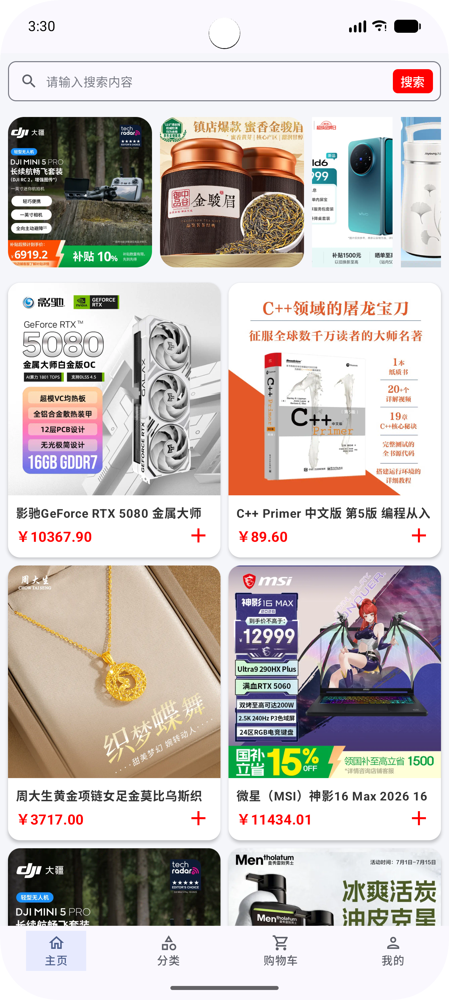

#### 浮游商城应用（Plankton Mall App）

- a
- b
- c
- d

#### Room 缓存

- 对于`Room`的所有读写操作，不应该放在`ViewModel`中，而应该全部封装在`Repository`，然后在`RepositoryImpl`中实现；
    - 单一职责（SRP）：`ViewModel`持有并处理 UI 状态、响应事件，`Repository`管理数据源（网络API、本地数据库、内存缓存）；
    - 数据源解耦：未来业务变化，只需修改`Repository`，不用改`ViewModel`；
    - 唯一数据源：`ViewModel`观察`Repository`暴露的`Flow`，遵循单向数据流；
- 最佳实践：
    - `ViewModel`收到用户操作 > 调用`Repository`的方法 > `Repository`写入`Room`；
    - `Repository`监听`Room`作为`Flow`（如：`fun observeCartLocalData(): Flow<List<CartProduct>>`）；
    - `ViewModel`中订阅收集`Repository`的`Flow`，收到自动更新 UI。

#### 其他

- “页面初始化”和“页面下拉刷新”不一样，页面初始化相当于 page reload，下拉刷新是一个手势逻辑；

#### 效果

- 竖屏
- 
